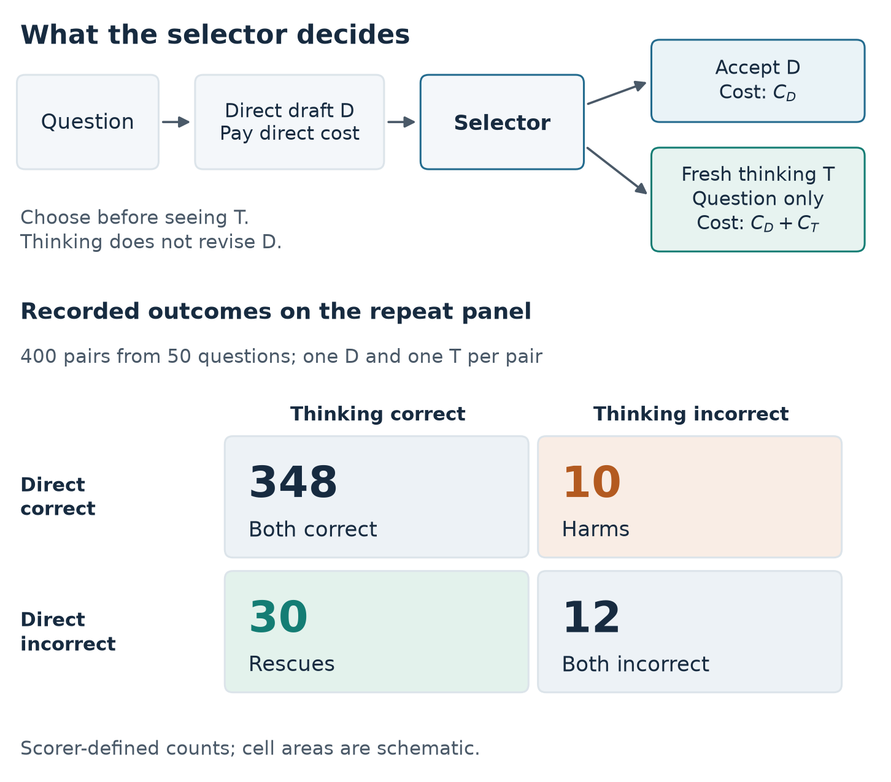
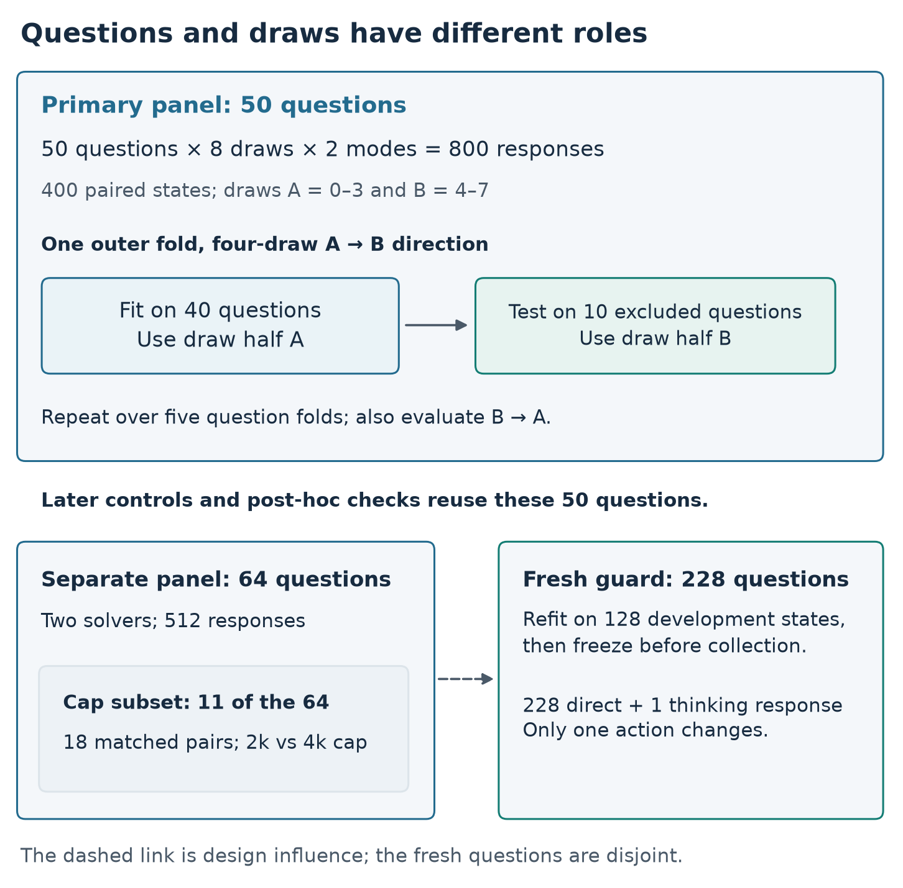
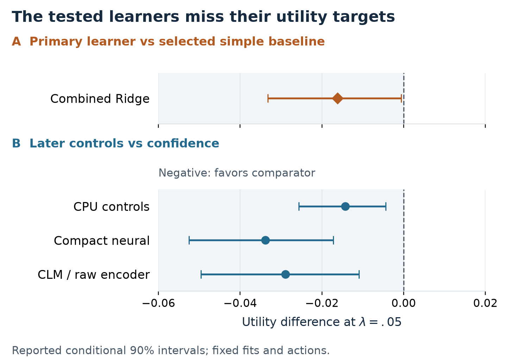
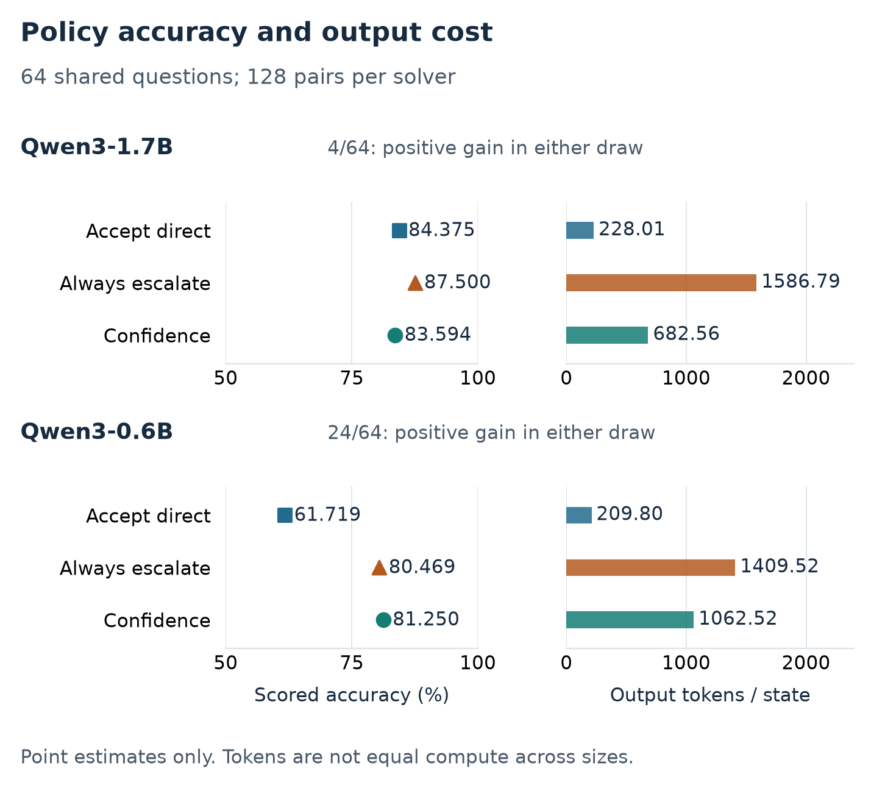

# Learned Deferral Did Not Beat Confidence When Escalating to Thinking: A Same-Model Cascade Study of Small Qwen3 Models on GSM8K

**Authors:** [Author names and affiliations to be supplied]

**Draft:** 0.5, 30 October 2026; adds a post-hoc confidence–gain audit (Section 5.2) to the v0.4 cascade reframing; author endorsement pending

## Abstract

A hybrid reasoning model can answer cheaply in direct mode and, when the answer looks unreliable, pay again for a thinking solve. This is a two-stage cascade in which both stages are the same model. Prior cascade work finds that deferring on low confidence often works well, while learned post-hoc deferral rules help in specific settings. We test learned deferral against confidence for small Qwen3 models on GSM8K. After one paid direct draft, a rule accepts the draft or buys a fresh thinking solve, and utility charges both calls. On 50 questions with eight draws per mode, thinking rescues 30 of 400 direct drafts and harms 10. The predeclared learned rule fails four of five progression criteria. Its average utility difference against a simple baseline selected within training is −0.016204, with a conditional 90% interval of [−0.033276, −0.000635]. Bounded capacity, contrastive-objective, and released-representation variants also fail to improve on confidence deferral on the same questions. On a separate 64-question panel, confidence deferral gains +0.152677 utility over accepting the draft for Qwen3-0.6B but loses 0.030540 for Qwen3-1.7B. A post-hoc check finds that expected gain falls as confidence rises for Qwen3-0.6B but not, in general, for Qwen3-1.7B. Post-hoc diagnostics suggest some question-level gain variation, so the results do not show that deferral is unlearnable. They show that the tested learned rules did not turn observed rescues into better deferral on held-out questions. One task, one model family, scorer-based correctness, intervals conditional on fitted policies, and the untested token-level quantile deferral recipe limit generalization.

**Keywords:** LLM cascades; deferral; adaptive reasoning; hybrid reasoning models; confidence; computational cost

## 1. Introduction

Hybrid reasoning models such as Qwen3 offer a direct mode and a thinking mode in one set of weights ([Yang et al., 2025](https://arxiv.org/abs/2505.09388v1)). Thinking usually improves accuracy, but it costs several times as many output tokens. A natural way to use both modes is to answer directly first and escalate to thinking only when the direct draft looks unreliable. In the language of model cascades, the direct mode is the first stage, the thinking mode is the second stage, and a deferral rule decides whether to call the second stage ([Chen, Zaharia, and Zou, 2023](https://arxiv.org/abs/2305.05176); [Jitkrittum et al., 2023](https://arxiv.org/abs/2307.02764)). Unlike most language-model cascades, both stages here are the same model.

The cascade literature gives a reason to expect a simple confidence rule to be competitive. [Jitkrittum et al. (2023)](https://arxiv.org/abs/2307.02764) characterize the optimal deferral rule and identify the settings where learned post-hoc deferral rules improve on confidence-based deferral: a specialist second model, label noise, and distribution shift. For generative language models, [Gupta et al. (2024)](https://arxiv.org/abs/2404.10136) find that sequence-level uncertainty suffers from a length bias and that learned deferral on quantiles of token-level uncertainty improves on simple aggregation. For deciding when to invoke reasoning, [Lewis-Lim et al. (2026)](https://arxiv.org/abs/2510.21007) find that training-free confidence measures do better than random, but that no single measure works consistently across datasets and models.

We ask whether a learned post-hoc deferral rule improves on confidence deferral in this same-model cascade when the training data contain repeated outcomes for each question and evaluation uses held-out questions. The contract is fixed. A small Qwen3 model first produces a direct draft. A rule then accepts that draft or requests a fresh thinking solve from the same model. The thinking call receives the question; it does not continue or revise the observed draft. The direct cost has already been incurred, so escalation pays for both calls. We use GSM8K, a dataset of mathematical word problems introduced by [Cobbe et al. (2021)](https://arxiv.org/abs/2110.14168v2).

The central study collects eight responses per mode on 50 Qwen3-1.7B questions. Question folds exclude evaluation questions from fitting and tuning. Two disjoint response halves supply different realizations of training and evaluation outcomes. The halves reuse question groups, and each draw has a different direct draft. They do not supply two independent study replications or repeated thinking outcomes for one identical draft state.

We separate three levels of evidence. Observed rescues show that deferring sometimes corrects a draft; they are hindsight opportunities, not a deployable rule. Repeated outcomes on the same questions can reveal question-level variation in the gain from deferring. A learned rule must then use permitted features to defer on questions excluded from fitting. Success at one level does not establish success at the next.

The paper reports three scoped findings:

1. **Learned deferral did not use the observed opportunities.** In 400 paired states, thinking rescues 30 direct drafts and harms 10. The predeclared learned rule fails its progression criteria on held-out questions, although post-hoc diagnostics suggest some question-level gain variation. Flagged scorer presentation cases cannot reverse the primary point contrast.
2. **Three plausible improvements to the learned rule also fail.** Stronger regularization and compression, a compact contrastive objective, and released contrastive representations with a matched-encoder control do not establish an improvement over confidence deferral on the reused panel.
3. **The value of the cascade depends on the solver, and narrow follow-ups add little.** On a shared 64-question panel, confidence deferral helps Qwen3-0.6B and lowers point utility for Qwen3-1.7B relative to accepting the draft. A post-hoc check finds that expected gain falls with confidence for the smaller solver but not, in general, for the larger one. A parser guard frozen before a 228-question test and a larger reasoning cap on 11 selected questions each produce at most one rescue.

Prior work already establishes confidence-gated thinking, deferral after observed drafts, the length bias of sequence-level confidence, repeated supervision, and the difference between failure risk and action value. Our contribution is a measured case under an explicit contract, which places a failed learned rule beside the cascade analysis that identifies when such rules should help. We did not test the token-level quantile deferral recipe of Gupta et al. or a faithful external system, and the studies do not identify why the learned rules fail.

## 2. Related work

### 2.1. Cascades and deferral rules

Language-model cascades send each query to a cheap model first and defer to a stronger model when a deferral rule fires. FrugalGPT learns a scoring function on the cheap model's answer to decide whether to continue to the next model ([Chen, Zaharia, and Zou, 2023](https://arxiv.org/abs/2305.05176)). [Yue et al. (2024)](https://proceedings.iclr.cc/paper_files/paper/2024/hash/5de11e930c1bbfda5d4fc9d2b0924032-Abstract-Conference.html) use the consistency of sampled answers from a weaker model, including mixed chain-of-thought and program-of-thought samples, to decide when to call a stronger model. AutoMix uses few-shot self-verification by the smaller model and a router based on a partially observable Markov decision process ([Aggarwal et al., 2024](https://proceedings.neurips.cc/paper_files/paper/2024/hash/ecda225cb187b40ea8edc1f46b03ffda-Abstract.html)). [Fanconi and van der Schaar (2025)](https://arxiv.org/abs/2506.11887v3) place a confidence-based decision to accept or regenerate a base model's answer before a further human-escalation decision.

[Jitkrittum et al. (2023)](https://arxiv.org/abs/2307.02764) analyze when the simplest rule, deferring when the first model's confidence is low, is sufficient. They characterize the optimal deferral rule, which depends on both models rather than on the first model's confidence alone. They show that post-hoc deferral rules, trained after both models are fixed, can improve on confidence when the second model is a specialist, when labels are noisy, or when the training and test distributions differ. [Gupta et al. (2024)](https://arxiv.org/abs/2404.10136) study cascades of generative language models. They report that sequence-level uncertainty over- or under-weights outputs according to their length, and that learned post-hoc deferral on token-level uncertainty quantiles is more consistent than simple aggregation, with further gains from model embeddings.

Our decision is a two-stage cascade in this sense, with one difference: both stages are one hybrid model, so the second stage is a different inference mode rather than a different model. Our primary learner is a post-hoc deferral rule. It predicts the cost-adjusted gain of deferring from question and draft features. Our confidence feature is the mean direct-answer token log probability, a sequence-level aggregate of the kind Gupta et al. found to be length-biased. The learned rules add log answer length, but no token-level quantiles. We therefore did not test the strongest documented post-hoc recipe for generative cascades.

### 2.2. Adaptive thinking in hybrid models

[Lewis-Lim et al. (2026)](https://arxiv.org/abs/2510.21007) study confidence-gated chain of thought. A model answers directly, and reasoning is invoked only when confidence in the direct answer is low. Across two model families, training-free confidence measures reduce redundant reasoning and outperform randomly invoked reasoning, but the most useful measure changes with the dataset and the model. This is the closest training-free counterpart to our confidence rule. Our study adds learned deferral rules, repeated draws, held-out question folds, and a cost that charges both calls.

[DART (Lee et al., 2026, v4)](https://arxiv.org/html/2606.23181v4) routes after observing direct drafts. Its default rule accepts agreement between two drafts and requests fresh thinking on disagreement, with an entropy-based budget. It also reports supervised-router failures; its main evaluations use single runs. Our study fixes one paid draft, a thinking allowance, and output-token utility, then evaluates learners across repeated response halves and held-out questions. These differences define our experiment. They do not establish priority for post-draft routing. We have no faithful DART comparison.

Other methods decide before any draft exists or change the decision space. [Self-Route (He et al., 2025)](https://arxiv.org/abs/2505.20664) trains a linear router on hidden-state representations to choose a reasoning mode before generation. [Thinkless (Fang et al., 2025)](https://arxiv.org/abs/2505.13379v2) uses reinforcement learning to select reasoning behavior. [BEST-Route (Ding et al., 2025)](https://arxiv.org/abs/2506.22716v1) selects a model and an inference sample count. Our controls do not reproduce these systems.

### 2.3. Routing evaluation and representations

Several recent audits caution against reading routing headroom as usable action value. [Chen (2026, v3)](https://arxiv.org/html/2607.03436v3) separates stochastic single-commit ceilings from hindsight unions and audits coupling and scorer choices. Its Appendix C also evaluates a learned policy on held-out questions using repeated archived outcomes, with historical exposure acknowledged. Repeated outcomes and held-out fitting are therefore already present in that work. [Garg and Sagtani (2026)](https://arxiv.org/html/2605.07395v1) examine judging, truncation, formatting, and router collapse, including random-feature, shuffled-label, and balanced-objective checks. Our flagged-case bounds address one restricted scorer explanation; they do not reproduce that mechanism analysis or exclude other scorer errors. [Yang et al. (2026)](https://arxiv.org/html/2608.14927v1) hold the solver fixed and distinguish failure-risk prediction from collaboration payoff, using one deterministic outcome per problem and protocol. The distinction between failure risk and useful escalation is established prior work.

[RouterDC (Chen et al., 2024)](https://proceedings.neurips.cc/paper_files/paper/2024/hash/7a641b8ec86162fc875fb9f6456a542f-Abstract-Conference.html) learns query/model and query/query contrastive objectives, and its open-ended supervision averages sampled responses. Repeated solver labels and contrastive routing therefore precede this study. [Cost-Spectrum Contrastive Routing (Shirkavand et al., 2025)](https://arxiv.org/abs/2508.12491v3) adds cost-sensitive selection in a shared representation space. [SEMIROUTER (Wang et al., 2026)](https://aclanthology.org/2026.eacl-long.228/) studies sparse supervision and adaptation to changing model pools.

Our compact representation uses the released [all-MiniLM-L6-v2 model](https://huggingface.co/sentence-transformers/all-MiniLM-L6-v2), which already has contrastive sentence-level training. The objective study changes a small routing head; it does not compare contrastive pretraining with its absence. The released Contrastive Language Models (CLM) diagnostic uses state/action heads documented in the [official CLM release](https://huggingface.co/Contrastive-LM/CLM-v0.1-8B). We cite it as an author release and implementation; no proceedings publication was verified.

Taken together, prior work establishes the components of our setting. The added evidence here is a measured same-model cascade in which observed rescues and some repeated question-level structure coexist with failed held-out deferral by the specified learned rules. The absence of token-level quantile deferral and of a faithful external-method comparison limits conclusions about the strongest available deferral rules.

## 3. Decision contract and evaluation

### 3.1. Accept a draft or buy a fresh solve

Let \(D\) be a completed direct response and \(T\) a fresh thinking response. Let \(Y_D,Y_T\in\{0,1\}\) denote correctness under the frozen scorer. Let \(C_D,C_T\) denote charged output tokens, including inserted closure tokens. An action \(a=1\) requests thinking; \(a=0\) accepts the draft. We use

\[
U(a)=Y_D+a(Y_T-Y_D)-\lambda(C_D+aC_T)/1000,\qquad \lambda=0.05.
\]

The incremental gain target is

\[
G=Y_T-Y_D-\lambda C_T/1000.
\]

The direct cost cancels in \(G\), but remains in total policy utility. A rescue means that a scored incorrect draft is replaced by a scored correct response. A harm is the reverse. Positive utility gain is a cost-dependent event. It is not a general label that a question “needs thinking.”

In cascade terms, \(a=1\) defers to the second stage. Because \(U\) is linear in \(a\), a rule that knew the expected gain given the question and draft would escalate exactly when that expectation is positive. This parallels the optimal deferral rule of [Jitkrittum et al. (2023)](https://arxiv.org/abs/2307.02764), which compares the expected reduction in error with the cost of deferring; here the cost also varies with the length of the thinking response. A confidence rule escalates when confidence falls below a threshold. It can approach the optimal rule only to the extent that lower confidence indicates a higher expected gain; Section 5.2 checks this descriptively. A learned post-hoc rule instead estimates the expected gain from permitted features, which is what the primary learner in Section 3.4 does.

The value \(\lambda=.05\) is the frozen cost preference for these studies. Utility counts generated and inserted output tokens used by a policy. It excludes input processing, router encoding, energy, and complete latency. Collection-ledger charges in Appendix A also include failed attempts and unresolved reservations; they measure a different expenditure.

The router can use the question, the permitted features of the observed direct draft, and fixed model information. It cannot use the future thinking text, thinking correctness, thinking length, or reference answer. Confidence is the mean direct-answer token log probability after temperature and sampling filters. It is a ranking feature, not a calibrated probability of correctness. Lower confidence can trigger escalation. Raw model confidence is retained as a separate measurement and does not replace the primary feature.

Figure 1 shows the decision before thinking is observed and the recorded outcomes available after collection; its "selector" is the deferral rule. A rescue changes scored correctness; its value to a policy also depends on the extra cost.

**Figure 1. Decision and observed outcomes. A selector accepts a paid direct draft or requests a fresh thinking solve from the question alone. Escalation pays for both calls. The matrix shows the four scored outcome categories among all 400 direct/thinking pairs on the 50-question repeat panel. A pair matches sample indices; the two modes use different seeds. These are observed counts, not predictions or utility-gain labels. Every pair contributes once, and cell area does not encode its count.**

[Figure 1 PDF](figures-v2/output-r2/pdf/figure-01-decision.pdf) · [Figure 1 SVG](figures-v2/output-r2/svg/figure-01-decision.svg)

### 3.2. Data, solvers, and scoring

All reported new question panels come from eligible GSM8K upstream training rows. Roles are frozen and checked for identity and normalized-prompt overlap. The project's official-test allocation is sealed. Neither reserved confirmation study contributes results to this paper. Question separation in these experiments does not establish separation from model pretraining.

The primary repeat study uses Qwen3-1.7B. The two-solver diagnostic adds Qwen3-0.6B. Both retain the same boxed-answer prompt and the specified mode interface. The normal reasoning allowance is 2,048 tokens, followed by an answer allowance of 512 tokens. Forced closure, when needed, is charged. Exact revisions and study contracts are listed in Appendix A.

The main routing studies use the frozen numeric-v7 scorer. Incomplete or rejected outputs count as incorrect under that endpoint. Parser acceptance alone does not certify mathematical correctness. A separate gold-free compatibility study examined presentation handling without replacing primary labels. Human answer scoring was explicitly waived. Consequently, our reported correctness is scorer-based correctness.

For the repeat, two-solver, sparse, and cap studies, selected training references were accessed only after the applicable full endpoint and required completion checks. Later manuscript preparation uses completed reports. The earlier engineering bridge has a different reference-materialization history, stated in Appendix A.

### 3.3. Evidence units and chronology

A paired state contains one direct response and one fresh thinking response for the same question and sample index. The two modes use different seeds. Table 1 separates unique questions, responses, and the use of each panel. A fit is not a new dataset. A repeated draw is not a new independent question. The paper's organizing research questions were formulated retrospectively; the individual studies' recorded grids, endpoints, and progression criteria were specified before their respective execution.

**Table 1. Evidence blocks and their scope.** The control studies reuse the repeat panel; their fit counts do not add independent questions. The cap questions are a subset of the two-solver panel. The fresh guard contrast uses a separately fitted and frozen policy.

| Block | Questions and responses | Evaluation or use | Main limit |
|---|---|---|---|
| Repeated supervision | 50 questions; 800 responses; eight draws per mode | Five question folds; independent response halves | Small diagnostic panel |
| Capacity, MiniLM, and CLM controls | Same 50 questions and cached responses | Later bounded development studies with the same folds/halves | Research reuse; no new confirmation |
| Two-solver diagnostic | 64 separate questions; 512 responses | Two draws per mode and solver; thresholds fitted on other questions and the opposite draw | One model family; two draws |
| 0.6B learned pilot and parser control | Same 64 questions; 128 paired outcomes | Fixed candidate and controls; training-only fitting | Reused development panel |
| Fresh sparse parser-guard contrast | 228 disjoint questions; 228 direct and one activated thinking response | Policies frozen before fresh collection | Only the policy difference is identified |
| Matched cap intervention | 11 selected questions from the 64-question panel; 18 pairs and 36 new responses | Same question/seed, 2k versus 4k reasoning allowance | Enriched development cohort |

Figure 2 separates the question split from the draw split and shows which later studies reuse questions.

**Figure 2. Sampling and study roles. The primary panel contains 50 questions, eight independent draws per mode, and 800 responses, paired into 400 states by sample index. Each outer fold fits on 40 questions and evaluates on ten excluded questions. The diagram shows the four-draw A-to-B direction; B-to-A reverses the draw halves while retaining question separation. Direct drafts change across draws. Later controls and post-hoc diagnostics reuse these 50 questions. The separate 64-question panel supplies the 11-question cap subset and the development states used to refit the guard before its 228 fresh questions. The latter link indicates design influence, not shared questions or replication. Box sizes are schematic.**

[Figure 2 PDF](figures-v2/output-r2/pdf/figure-02-design.pdf) · [Figure 2 SVG](figures-v2/output-r2/svg/figure-02-design.svg)

### 3.4. Independent response halves and grouped selection

In the repeat panel, each question has eight independently seeded responses in each mode. Direct and thinking seeds differ. Responses are paired by sample index for replay; we do not form all \(8\times8\) combinations. Half A contains indices 0–3 and half B contains indices 4–7.

For \(k\in\{1,2,4\}\), the learner fits on the first \(k\) draws of training questions from one half. It is evaluated on all four draws of held-out questions from the opposite half. We report both A→B and B→A. Five outer folds each contain ten questions. Four inner question folds select settings using only the allowed training-half outcomes.

All outcomes for an outer evaluation question are excluded from its model fitting and tuning. The opposite halves check sensitivity to different realizations of training and evaluation draws. Both directions reuse the same question groups and exchange their draw roles. They are not independent study replications, and no matched comparison establishes an advantage from the half-split design itself.

The predeclared reproducibility diagnostic tests how well each question's source-half mean gain predicts its opposite-half mean gain. Here, reproducibility refers to this mean-squared-error test, not an independent replication of the study. Its comparator uses the mean gain of the other 49 questions in that source half. We average the reduction in mean squared error across both directions. This diagnostic concerns repeated question-level signal; it is distinct from router utility on held-out questions.

Direct drafts change across draws. Thus the same-question diagnostics concern repeated outcomes for a question, rather than repeated thinking outcomes conditioned on one identical draft. Neither these diagnostics nor the k=1/2/4 comparisons isolate the causal effect of acquiring more repeated labels.

The predeclared learner is combined Ridge regression on 387 question features and four draft features. The question block consists of 384 MiniLM coordinates and three lexical features. The draft block consists of confidence, log answer length, parser validity, and truncation. Standardization is fitted within training folds. The original Ridge penalty grid is \(\{1,10,100\}\). The learner escalates when predicted incremental gain is positive, so it is a post-hoc deferral rule in the sense of Section 2.1. Question-only and draft-only variants are diagnostics.

The original simple comparator is selected within training from always accept, always escalate, and a confidence threshold. This differs from later controls, which compare directly with confidence. For later model families, “training-selected” means that the permitted training data choose the model settings used for evaluation; held-out-question labels do not enter that choice. A secondary full-eight analysis trains on all eight draws of training questions and tests on all eight draws of held-out questions. It has no independent same-question eight-draw replica.

### 3.5. Uncertainty and progression

Repeat and router-control intervals use 2,000 whole-question bootstrap resamples and two-sided 90% intervals under each study's frozen seed. Actions and fitted policies remain fixed. These are resampling summaries of the recorded question-level policy differences. They omit variation from refitting, threshold selection, new training draws, optimization seeds, and the research path. They provide no simultaneous coverage across the displayed comparisons. The fresh sparse and cap studies retain their original 95% interval convention. The post-hoc confidence–gain audit in Section 5.2 uses the repeat-study convention.

Outer-fold models share training questions. Resampling whole evaluation questions preserves their repeated-outcome groups, but does not reproduce the dependence created by overlapping training sets. Nested selection controls which labels enter each specified fit. It does not remove later research reuse. Consequently, an interval below zero does not by itself establish inferiority of the learning algorithm across future training sets. Sparse-event limitations require an additional qualification in Section 5.4.

A progression screen is a set of predeclared criteria for deciding whether to continue a research direction. The primary repeat study requires all five criteria in Table 2. CPU, MiniLM, and CLM screens require average utility gain of at least .01, positive means in both directions, and a positive averaged mean after deleting each question in turn. The two-solver diagnostic requires at least ten positive-gain questions, plus confidence gain of at least .01 and positive points in both directions. Its positive-gain count differs from the repeat study's count of any correctness difference. Sparse validation requires gain of at least .01 and a positive lower 95% interval bound.

The progression criteria are related decisions on the same outcomes, rather than independent tests of one mechanism. Later screens cannot replace a failed primary endpoint. We report all original decisions. A favorable secondary result does not promote a different candidate after outcomes.

## 4. Learned deferral on the repeat panel

### 4.1. Observed rescues and a failed primary learner

Across the 400 paired states, direct accuracy is 89.5% and standalone thinking accuracy is 94.5%. There are 30 rescues, 10 harms, 348 pairs where both responses are correct, and 12 where both are wrong. These counts establish realized opportunities on the 50 measured questions. A selector must still predict useful actions without observing the future thinking outcome.

The combined learner's averaged four-draw difference against the training-selected simple comparator is −0.016204, with a conditional 90% interval of [−0.033276, −0.000635]. Four of five progression criteria fail.

**Table 2. Original repeat-study criteria.** The interval for reproducibility measures squared utility units. Other gain rows measure utility. Intervals are conditional 90% summaries on the same 50 questions. Learner utility is compared with the simple baseline selected within training, not an assumed confidence policy in every condition.

| Criterion | Recorded result | Decision |
|---|---|---|
| Positive four-draw reproducibility improvement with positive interval lower bound | MSE improvement +.01158; 90% interval [−.01744, +.04848] | Fail |
| Positive combined-minus-baseline gain in both four-draw directions | A→B −.02679; B→A −.00562 | Fail |
| Average four-draw gain at least +.01 with positive interval lower bound | −.016204; [−.033276, −.000635] | Fail |
| No reversal in the secondary full-eight comparison | −.05163; [−.07286, −.03204] | Fail |
| At least ten informative questions with a correctness difference | 14 of 50 | Pass |

The smaller training conditions also vary across directions. With one draw, differences are −.02016 and +.00641. With two draws, they are −.02812 and +.02257. These conditional point estimates do not establish a monotonic learning curve or show that repeated supervision is generally harmful.

**Box 1. Post-hoc question structure and bounded scorer sensitivity.** These separately reported diagnostics reuse the completed repeat panel and its recorded labels. The intervals are conditional whole-question summaries. The scorer sensitivity is a point bound, not an interval. These diagnostics do not replace Table 2 or change its decisions.

| Diagnostic | Recorded result | Interpretation limit |
|---|---|---|
| Signed between-question gain variance | .03233 utility²; conditional 90% interval [.00541, .06530] | Suggests between-question variation under approximately IID/exchangeable within-question draws. It is a different statistic from the failed primary MSE test. |
| Same-question action selection using A, evaluated on B | Gain over accepting direct +.04413; 90% interval [.00563, .08845] | Uses prior labels of those same questions; label-acquisition expenditure is omitted. |
| Same-question action selection using B, evaluated on A | Gain over accepting direct +.01572; 90% interval [−.02019, .05908] | The interval crosses zero. Different directional point estimates do not establish a statistically tested directional difference. |
| Fixed-policy sensitivity to five flagged presentation cases | Averaged four-draw learner-minus-baseline point difference stays −.016204 | Keeps actions and costs fixed. It does not cover unflagged scorer errors or refitted policies. |

The variance estimate subtracts estimated within-question sampling variation from variation in question means and is deliberately left unclipped. Its interpretation depends on the stated draw assumptions. The same-question comparisons use four draws to select an action and evaluate it on the opposite half. Acquiring the labels in A and B used 322,882 and 321,508 tokens, respectively. Those costs are absent from the reported transfer gains. The comparisons therefore provide neither net acquisition utility nor performance on unseen questions.

The scorer bound asks whether any subset of five flagged rejected outputs becoming correct could reverse the primary comparison. Both policies choose the same final mode on those affected draws, so the primary point difference is unchanged. Including a sixth unmarked-terminal case can only worsen that difference. These are fixed-policy point bounds, not confidence intervals or general validation of mathematical scoring. The [completed diagnosis](../../docs/phase-2-repeat-results.md#separate-post-hocdevelopment-explanation) and [syntax-bound record](../../docs/phase-2-repeat-results.md#gold-free-parser-triage-and-bounded-sensitivity) supply these results.

Taken together, the observations suggest some structure on measured questions while the primary learner fails on held-out questions. The data do not establish that the permitted features can recover that structure, or identify the reason for the gap. The failed primary reproducibility criterion remains part of this conclusion.

#### Secondary full-eight behavior

The full-eight results help describe the failure. Combined Ridge escalates on 174 of 400 states, with five positive-gain decisions and 169 nonpositive decisions. The latter include seven harms. Confidence escalates on 58 states, with 16 positive-gain decisions and 42 nonpositive decisions, including four harms. Combined Ridge misses 25 positive opportunities; confidence misses 14. These are descriptive counts on the reused panel.

The full-eight confidence policy reaches 92.50% accuracy at 466.88 tokens per state. Combined Ridge reaches 89.00% at 799.49 tokens. This secondary confidence endpoint must not be substituted for the four-draw confidence endpoint below.

### 4.2. Bounded capacity and objective controls

The capacity study tests stronger regularization, compressed question features, and conservative corrections to confidence. The compact study crosses question-only or question/draft representations with four objectives: gain regression, regret-weighted cross entropy, bidirectional contrastive loss, and binary cross entropy. All four compact objectives use the same small head and training-only selection. [Appendix A.3](#a3-control-implementation-and-encoder-timing) retains the architecture, optimization settings, and fit counts.

The losses target different quantities. We compare the utility of their selected actions; their scores are not interchangeable calibrated probabilities. The shared head controls this particular architecture and optimization recipe.

Neither training-selected family improves on confidence (Table 3). All eight neural family point differences are negative, although some individual intervals include zero. Draft encoding retains the final 256 tokens; 111 of 400 drafts are truncated. Mean-vector fusion, compression, truncation, and one optimization seed constrain the result.

### 4.3. Released CLM with a matched encoder control

We separately evaluate released CLM heads on pinned 4-bit Qwen3-8B last-token representations. The heads are not fine-tuned. The state includes the question, direct draft, and fixed decision metadata. It excludes thinking output, outcome labels, future thinking cost, and confidence.

The comparison includes zero-shot released scores, scalar gain calibration, and a PCA8/Ridge control on the same encoder representations. The learned families do not add draft statistics. They use the same permitted training data and grouped selection rules. A matched backbone controls the encoder identity; differing head capacity, training history, and feature dimensions prevent isolation of a contrastive-pretraining effect.

The CLM state and learned families exclude confidence and auxiliary draft statistics. This tests the specified representation-transfer recipes. It does not test whether adding CLM features to confidence improves selection.

**Table 3. Average across A4→B4 and B4→A4 on the same 50 questions.** Tokens include the paid direct draft and any inserted closure. Differences are against the four-draw confidence policy, distinct from the secondary full8 policy. Intervals keep fits and actions fixed and do not provide joint coverage or refitting uncertainty. All listed learned/transfer screens fail.

| Policy | Accuracy | Tokens/state | Utility difference | Conditional 90% interval |
|---|---:|---:|---:|---|
| Confidence | 92.75% | 628.47 | Reference | — |
| Training-selected CPU family | 90.75% | 514.22 | −.014287 | [−.025680, −.004425] |
| Training-selected compact neural family | 89.25% | 604.82 | −.033817 | [−.052515, −.017266] |
| Released CLM, zero-shot | 94.75% | 1,550.53 | −.026103 | [−.058826, +.016513] |
| Released CLM, calibrated | 88.50% | 443.71 | −.033262 | [−.053818, −.015171] |
| Same encoder, PCA8/Ridge | 89.00% | 330.81 | −.022617 | [−.043758, −.004464] |
| Training-selected CLM/raw family | 88.75% | 406.34 | −.028893 | [−.049575, −.010922] |

Figure 3 shows the negative recorded utility differences for the primary learner and later controls, with their different comparators kept in separate panels.

**Figure 3. Recorded four-draw utility differences on the same 50 questions. Panel A compares the primary learner with a baseline selected within training from accept, escalate, and confidence. Panel B compares later families selected within training with confidence. Dots and bars show the reported means and conditional 90% whole-question bootstrap intervals. Fits and actions stay fixed; intervals omit refitting and research-selection uncertainty and have no joint coverage. Negative values favor each stated comparator. Different comparators prevent a pooled effect. Exact values remain in Tables 2 and 3; all displayed screens failed.**

[Figure 3 PDF](figures-v2/output-r2/pdf/figure-03-utility.pdf) · [Figure 3 SVG](figures-v2/output-r2/svg/figure-03-utility.svg)

Calibrated CLM minus the raw encoder control is −.010645, with interval [−.018190, −.004292]. Both remain below confidence. Zero-shot CLM chooses thinking for 380 of 400 drafts. Its higher accuracy therefore comes with near-always-escalating cost. The interval for its utility difference includes zero; this is not proof of a population disadvantage.

Output-token utility excludes CLM encoder work. Separate encoding measurements are in [Appendix A.3](#a3-control-implementation-and-encoder-timing). Full-precision equivalence, pretraining overlap, and live solver/router co-residence remain untested. The finding concerns this quantized transfer recipe.

## 5. Limits of transfer

The supporting analyses examine four different targets: observed opportunities across two solvers, whether lower confidence indicates higher gain, a refitted parser-guard policy, and a larger thinking allowance on selected development questions. Their findings limit how far the main result can be extended. The two-solver comparison is in Section 5.1 and the confidence–gain audit in Section 5.2; Sections 5.3–5.5 give the guard and cap results, including the sparse-outcome limits. None replicates the primary learner comparison.

### 5.1. Opportunities differ across the two tested solver sizes

The separate diagnostic uses the same 64 questions for both solvers, with two draws per mode. Confidence thresholds are selected on other question folds and the opposite draw. Table 4 reports average outcomes across the two directions.

**Table 4. Two-solver diagnostic.** Each solver has 128 scored paired states grouped in the same 64 questions. Values average the two directions; reported contrasts use conditional 90% question-bootstrap intervals with actions fixed. They omit threshold-refit uncertainty. Always escalate includes direct plus thinking cost. Tokens from the two solver sizes are not equal compute units.

| Solver | Policy | Accuracy | Tokens/state | Utility |
|---|---|---:|---:|---:|
| Qwen3-1.7B | Accept direct | 84.375% | 228.01 | .832350 |
| Qwen3-1.7B | Always escalate | 87.500% | 1,586.79 | .795661 |
| Qwen3-1.7B | Confidence | 83.594% | 682.56 | .801809 |
| Qwen3-0.6B | Accept direct | 61.719% | 209.80 | .606697 |
| Qwen3-0.6B | Always escalate | 80.469% | 1,409.52 | .734211 |
| Qwen3-0.6B | Confidence | 81.250% | 1,062.52 | .759374 |

Qwen3-0.6B has 24 questions with positive realized gain in at least one of its two draws. Confidence-minus-direct utility is +.152677, with conditional 90% interval [+.085535, +.220375]. Qwen3-1.7B has four such questions. Its confidence-minus-direct difference is −.030540, with interval [−.056066, −.006071]. The smaller solver passes the diagnostic's availability and confidence screens; the larger solver fails both.

The positive-gain count depends on the number of sampled draws. It does not count questions known to have positive expected gain. Counts from this two-draw panel and the eight-draw repeat panel cannot be treated as directly comparable intrinsic opportunity rates.

The comparison establishes different observed opportunity patterns in these settings. It does not establish a general model-size law or a tested population interaction. It also limits a broad endorsement of confidence: confidence helps on one solver/panel combination and harms point utility on another. In cascade terms, the smaller solver had far more questions on which deferring realized a positive gain, and only there was confidence deferral worth its cost. [Lewis-Lim et al. (2026)](https://arxiv.org/abs/2510.21007) likewise report that the usefulness of training-free confidence gating varies with the model and dataset, although their measures and costs differ from ours.

Accepting the larger model's direct draft also has higher point accuracy and fewer generated tokens than the smaller model's confidence policy. These token counts are useful context, but tokens from different model sizes are not equal units of compute. No live cross-size latency or energy advantage is established.

Figure 4 aligns accuracy and output cost by policy. The observed confidence-versus-direct pattern differs between the two solver settings.

**Figure 4. The separate two-solver diagnostic, averaged across draw directions. Rows align each policy's scored accuracy and charged output tokens for 128 paired states in the same 64 question groups. Marks show reported point estimates; no accuracy or token interval is inferred. Both calls are charged on escalation. The 4/64 and 24/64 counts identify questions with positive realized gain in at least one of two draws at lambda=.05, not positive expected-gain labels. Tokens are not equal compute units across solver sizes. No population model-size effect or latency advantage is established.**

[Figure 4 PDF](figures-v2/output-r2/pdf/figure-04-diagnostic.pdf) · [Figure 4 SVG](figures-v2/output-r2/svg/figure-04-diagnostic.svg)

### 5.2. Does lower confidence mean higher expected gain?

Section 3.1 notes that a confidence threshold can approach the optimal deferral rule only to the extent that lower confidence indicates a higher expected gain. A post-hoc descriptive audit checks this on the repeat panel and on both solvers of the two-solver panel ([protocol](../../docs/confidence-gain-shape-protocol.md)). It groups paired states into five equal-count confidence bins and reports the mean gain per bin, the rank correlation between confidence and gain, and the gain from escalating the lowest-confidence states. It reads only cached scores; it fits no model and chooses no threshold. Its reading rule was fixed before execution: *consistent* when the 90% interval of the pooled rank correlation lies below zero and the lowest bin has the highest mean gain, *inconsistent* when that interval lies above zero, and *inconclusive* otherwise. Table 5 summarizes the results.

**Table 5. Mean gain by confidence bin.** Bins are equal-count fifths of each panel's paired states by direct-draft confidence (80 states per bin on the repeat panel, 25–26 on the two-solver panel). Each cell gives the mean gain \(G\) with its conditional 90% whole-question bootstrap interval, followed by rescues / both-wrong pairs in the bin. The best-threshold row escalates the lowest-confidence states and is chosen in-sample, so it is optimistic; the oracle escalates exactly the states with positive realized gain. The two solvers share the same 64 questions.

| Confidence bin | Repeat panel, Qwen3-1.7B | Two-solver, Qwen3-0.6B | Two-solver, Qwen3-1.7B |
|---|---|---|---|
| 1 (lowest) | +.0806 [−.0158, +.1757] · 17/4 | +.4221 [+.1920, +.6260] · 15/4 | −.0515 [−.2219, +.1376] · 3/5 |
| 2 | −.0445 [−.0822, −.0036] · 3/0 | +.2579 [+.1057, +.4273] · 8/7 | −.0379 [−.1611, +.0947] · 2/5 |
| 3 | −.0833 [−.1443, −.0316] · 2/0 | +.0565 [−.0470, +.1654] · 3/3 | +.0102 [−.0655, +.0954] · 2/3 |
| 4 | −.0300 [−.1153, +.0813] · 5/0 | +.0294 [−.1607, +.2219] · 5/2 | −.0525 [−.0596, −.0460] · 0/0 |
| 5 (highest) | −.0202 [−.0647, +.0563] · 3/8 | −.1271 [−.2982, +.0253] · 1/1 | −.0525 [−.0577, −.0467] · 0/0 |
| Pooled rank correlation | +.1553 [−.0021, +.2975] | −.1931 [−.3572, −.0251] | +.3439 [+.1612, +.4994] |
| Best in-sample threshold: share escalated; share of oracle gain | 11.7%; 32.9% | 66.4%; 71.8% | 0%; 0% |
| Reading | Inconclusive | Consistent | Inconsistent |

For Qwen3-0.6B, mean gain falls at every step from the lowest-confidence bin to the highest, and the two lowest bins hold 23 of the 32 rescues. The premise holds, which fits the large gain of confidence deferral over accepting the draft in Table 4. For Qwen3-1.7B it does not hold in general. On the repeat panel only the lowest-confidence fifth has positive mean gain, and its interval includes zero; 13 of the 30 rescues lie in higher bins, where the thinking cost outweighs them. The highest-confidence bin holds 8 of the 12 pairs in which both responses are wrong: these drafts are confidently wrong, and thinking does not repair them. On the two-solver panel the two lowest bins hold 10 of the 13 both-wrong pairs and the longest thinking responses, and no confidence threshold improves on accepting the draft even in-sample.

Most Qwen3-1.7B states have both responses correct, so their gain is the thinking cost alone. On all three panels, thinking responses are longer after the lowest-confidence drafts than after the highest-confidence drafts, which makes gain rise with confidence among these states. The positive pooled correlations for Qwen3-1.7B therefore mainly reflect thinking length rather than harms; the bins answer the threshold question more directly.

This audit was designed after all outcomes were known and reuses development panels. The best-threshold values are chosen in-sample, the intervals have no simultaneous coverage, and the two solvers share questions. It describes these panels; it does not test a deferral rule or change any criterion. The [results record](../../docs/confidence-gain-shape-results.md) gives the full bin decomposition.

### 5.3. Development evidence and the refitted guard

On the reused 0.6B panel, the three-feature Ridge pilot fails two of four criteria. Its utility difference against confidence is +.003516, with conditional 90% interval [−.031959, +.037163]. A control that also escalates parser-rejected drafts adds three escalations, all scored rescues, for +.022493 utility [+.007453, +.044905]. These fixed-action intervals omit refitting and research-selection uncertainty. The favorable control does not promote the failed learner.

The fresh study uses a separate plain-confidence cutoff refitted on all 128 development states. Both prospective policies share that frozen cutoff. The refit changes two training actions, compared with three under the earlier cross-fitted control. Thus the fresh contrast tests the newly frozen rule, with no exact replication of the earlier fitted policy. [Appendix C.1](#c1-development-pilot-and-guard-refit) retains the pilot settings, full control metrics, and cutoff.

### 5.4. Fresh sparse evaluation identifies only the policy difference

The fresh panel contains 228 disjoint questions. Let \(a_0\) denote the frozen plain-confidence action and \(a_1\) the parser-aware action. Define \(z=1[a_1\ne a_0]\). Changed states are drafts that plain confidence accepts and v7 rejects. They have \(Y_D=0\) by the fixed scoring rule without a direct-reference lookup. The guard only adds thinking, so its question-level utility difference is

\[
\Delta U=z(Y_T-Y_D-\lambda C_T/1000).
\]

When the actions agree, their difference is exactly zero. Therefore the fixed policy contrast can be evaluated by generating thinking only for changed states. The endpoint requires every direct response and every activated thinking response. This design does not identify either policy's absolute accuracy or utility.

Only one of 228 states changes action. Its extra thinking response uses 1,423 tokens, is rejected by numeric-v7, and is scored incorrect. There is no scored accuracy increment. The mean utility difference is −.000312061, with a 95% question-bootstrap interval of [−.000936184, 0]. The observed contributions are 227 zeros and one negative value. Resampling them cannot create an unobserved rescue. Thus the interval's upper endpoint of zero does not exclude positive population benefit from rare rescue events absent from this panel.

An elementary retrospective bound clarifies the role of the observed activation count. On changed states, \(Y_D=0\), \(Y_T\le1\), and thinking cost is nonnegative. Therefore

\[
\Delta U_i=z_i(Y_{T,i}-.05C_{T,i}/1000)\le z_i,
\qquad
\overline{\Delta U}\le\frac{1}{228}<.01
\quad\text{for the observed eligibility mask}.
\]

Even a rescue on the single activated call could not meet the .01 point-gain criterion on this panel, before charging thinking cost. This is a finite-panel bound with the mask held fixed. It does not estimate future activation rates, population gain, or statistical power. It leaves the completed endpoint and failed screen unchanged.

The frozen follow-up contrast supplies one activation without a scored rescue. One event cannot establish a general disadvantage for parser-aware routing. Most shared-action outcomes and 227 references were deliberately not observed. Reporting absolute policy accuracy for this panel would exceed what the design identifies.

### 5.5. A matched reasoning-cap intervention

The cap intervention compares 2,048 with 4,096 reasoning tokens in 18 matched pairs on 11 development questions selected by prior forced-closure metadata. With equal question weights, it produces one rescue, no harms, and +4.55 percentage points of scored accuracy. Extra thinking-call cost is +1,662.45 tokens; utility is lower by .037668, with paired conditional 95% interval [−.094767, +.061647]. The interval includes zero. This selected-cohort result does not support changing the default at λ=.05 or establish a general cap effect. [Appendix C.2, Table C1](#c2-matched-cap-results) retains the full table, matching checks, and weighting and scorer limits.

## 6. Discussion

### 6.1. Possible reasons the learned rules did not beat confidence

The main observation joins three different results: scored rescues, limited post-hoc evidence of repeated question structure, and unsuccessful deferral by the tested learned rules on held-out questions. A positive variance estimate and same-question transfer points concern the measured question distributions. A deployable rule must infer an action from permitted features on other questions. The present results leave that step unresolved.

This interpretation retains the failed primary reproducibility test. The post-hoc diagnostics measure different quantities and have their own assumptions. They cannot rescue the primary decision or prove that useful feature-level signal was available to the learner.

The cascade analysis offers one reading of the result, which we did not test directly. [Jitkrittum et al. (2023)](https://arxiv.org/abs/2307.02764) identify three settings in which post-hoc deferral improves on confidence: a specialist second model, label noise, and distribution shift. Our second stage is the same model in a different mode. It is more accurate on average (94.5% versus 89.5% across the 400 paired states), and we have no evidence that it is strong only on an identifiable subset of inputs. Training and evaluation questions come from the same eligible GSM8K pool, so there is no designed distribution shift. The closest analogue of label noise is the pairs in which both responses are scored wrong. Section 5.2 shows that their location differs by panel: on the repeat panel, 8 of 12 sit in the highest-confidence bin, where a low-confidence rule would not escalate anyway, while on the two-solver panel 10 of 13 sit in the two lowest bins, where confidence spends escalations on them. A learned rule could in principle avoid such cases, but whether these panels contain enough of them to reward one is untested. On this reading, the documented advantages of post-hoc deferral were not clearly present here. That is consistent with the observed failure but does not establish its cause.

The strongest documented post-hoc recipe for generative cascades was also absent. Our confidence is a mean of token log probabilities, a sequence-level aggregate that [Gupta et al. (2024)](https://arxiv.org/abs/2404.10136) found to be length-biased. Our learned rules add log answer length but not token-level quantiles. A rule built on token-level quantiles might find signal that our features miss; this remains open.

Section 5.2 gives a descriptive picture of the difficulty for Qwen3-1.7B. The rescues that a deferral rule could exploit are spread across confidence levels, and in most bins they are outnumbered by states whose gain is only the thinking cost. A confidence threshold can capture at most the lowest tail. A learned rule would need features that separate the remaining rescues, and the tested learned rules did not achieve this.

With 40 unique outer-training questions, the original 391-feature combined representation has many more coordinates than independent training groups. Repeated rows add response information while reusing those groups. This is a plausible constraint on learning, but the present studies do not identify it as the cause.

The capacity controls matter because they test a simple response to that concern. Stronger regularization, PCA compression, and confidence corrections also fail their bounded screens. The representation controls similarly show that this compact objective change and this released transfer recipe do not supply a demonstrated improvement. The combined evidence narrows these recipes. It does not exhaust larger datasets, other features, other fusion methods, or other model families.

### 6.2. Confidence as a reference policy

Confidence is inexpensive and competitive on the repeat panel. It remains a necessary reference for the studied deferral rules. The separate 1.7B diagnostic nevertheless gives lower confidence utility than direct acceptance. Thus the evidence does not justify recommending confidence deferral in every setting, in line with the dataset and model dependence reported by Lewis-Lim et al. (2026). Section 5.2 suggests a reason for that diagnostic: there, low confidence marks questions on which thinking also fails and runs longest.

The smaller solver has more observed opportunities, but this does not automatically yield a successful learned improvement over its confidence baseline. The three-feature pilot illustrates this distinction. A system-level choice must also consider the stronger direct solver, with full compute and latency accounting rather than only token counts.

### 6.3. Each follow-up estimates a different quantity

The parser control and cap study answer different questions. The fresh guard test measures the incremental effect of one frozen policy modification. It deliberately leaves shared-action outcomes unmeasured. The cap intervention measures the effect of a larger allowance on previously selected cells. It has tighter token-stream matching but a narrow cohort.

Neither study can replace the repeat learner's failed endpoint. Their contribution is to prevent a favorable development count from becoming a broad improvement claim. The absence of a supported gain is informative for these decisions, even when sparse events prevent a strong population conclusion.

### 6.4. Scoring and cost are part of the result

Frozen scoring makes comparisons interpretable across stages. Gold-free presentation checks can identify compatibility issues, but cannot decide mathematical correctness. Replacing primary labels after inspecting outcomes would define a different study. We therefore retain original labels and separate syntax sensitivity from the policy results.

Output-token utility expresses the frozen preference at λ=.05. It charges generated and inserted tokens for the direct draft and extra thinking where required. It does not price input processing, encoder work, energy, or complete latency. Training acquisition, collection-ledger charges, and deployment cost are distinct. The measured CLM encoding overhead reinforces the need to report them separately. The tables retain accuracy and token counts so that the utility result is tied to its stated preference.

## 7. Limitations

The study uses one mathematical dataset and two small solver sizes from one family. All panels use eligible upstream training questions. Question-role checks protect project splits but cannot rule out pretraining exposure. We do not claim cross-task generalization.

The principal learner and representation results reuse 50 questions. Later study designs were informed by earlier results. Nested fitting protects the specified fit, but does not remove that research exposure. The bootstrap keeps fits and actions fixed, omits new training and optimization realizations, and does not reproduce overlapping-fold training dependence. It does not provide joint coverage across comparisons. The organizing paper-level hypotheses were not a single prospective registration. The confidence–gain audit in Section 5.2 is post-hoc on the same reused panels, and its best-threshold values are chosen in-sample.

Only one optimization seed is used in the compact neural study. Some drafts are truncated. The released CLM test is quantized and uses a particular state format, calibration, and small raw-feature control. Its pretraining overlap and full-precision equivalence are unknown. The comparison does not test adding CLM features to confidence.

The refitted parser follow-up has one changed event. Its empirical bootstrap cannot represent unseen rescue events, and its finite-panel ceiling does not bound population benefit. The cap study has 11 selected groups and one rescue. These observations cannot settle broad hypotheses about parser guards or reasoning budgets. Human scoring was waived, so scorer mistakes remain a limit even where extraction is accepted.

We did not evaluate token-level quantile deferral, agreement-based deferral on the same folds, or a faithful external system. Our reading of the results through the cascade analysis is an interpretation; we did not test whether the conditions identified by Jitkrittum et al. (2023) hold in this setting.

Finally, runtime recoveries and local resource contention prevent causal speed claims. No complete co-resident deployment benchmark, external-method superiority test, or sealed confirmation is reported.

## 8. Conclusion

Escalating from a direct draft to a fresh thinking solve is a same-model cascade. On the studied GSM8K/Qwen3-1.7B panel, thinking sometimes rescues a direct draft, yet the primary learned deferral rule and later bounded variants do not establish utility gains over their specified simple comparators on held-out questions. Post-hoc diagnostics suggest limited repeated question-level structure. Same-question transfer omits acquisition cost, one directional interval crosses zero, and the primary reproducibility criterion remains failed. The flagged presentation cases alone cannot reverse the primary fixed-policy point comparison.

The value of confidence deferral itself differed sharply between the two solver sizes. A post-hoc audit finds that expected gain falls with confidence for the smaller solver but not, in general, for the larger one, whose rescues are spread across confidence levels. The narrow guard and cap follow-ups produced at most one rescue each. These studies address different targets and identify no common failure mechanism. The settings in which the cascade analysis expects learned deferral to help were not clearly present here. A broader claim requires prospective evidence on tasks with more rescue opportunities, token-level deferral features, and new training and evaluation conditions.

## Data and code availability

The project retains versioned source, protocols, aggregate reports, score sidecars, and independent verification records. This manuscript is drafted from the tracked result records listed in Appendix B. Version 0.5 adds one post-hoc descriptive analysis (Section 5.2), computed from cached scores under a separately frozen [protocol](../../docs/confidence-gain-shape-protocol.md); its generated [report](../../docs/confidence-gain-shape-report.md) and [results record](../../docs/confidence-gain-shape-results.md) are tracked. That analysis involved no generation, scoring, or reference access. No other new experiment or statistical reanalysis was performed for the manuscript. Figures 1–4 use the reported results under a separate [display revision plan](figures-v2/plan.md). The [display record](figures-v2/README.md) retains source and output identities and the original figures remain preserved. No effect or interval was re-estimated for these figures. Version 0.4 revises the title, abstract, introduction, related work, discussion, limitations, and conclusion, and adds cascade wording in Sections 3–5. All tables, Box 1, figures, captions, and appendices are unchanged, and no number was re-estimated. The LaTeX reviewer copy still reflects version 0.3. A public artifact release and its licensing review are pending. Sealed allocations and protected material are not part of a promised release.

## Author declarations

Author names, affiliations, contributions, funding, and conflicts of interest must be completed by the authors. AI assistance was used for drafting and research support. The authors must check the claims and references and assume responsibility for the submitted version. Automated engineering verification is not a human answer-scoring audit.

## Appendix A. Reproducibility and deviations

### A.1. Model and protocol identities

| Component | Fixed identity or contract |
|---|---|
| Qwen3-1.7B | Revision 70d244cc86ccca08cf5af4e1e306ecf908b1ad5e |
| Qwen3-0.6B | Revision c1899de289a04d12100db370d81485cdf75e47ca |
| Question/draft encoder | all-MiniLM-L6-v2, revision 1110a243fdf4706b3f48f1d95db1a4f5529b4d41 |
| Released CLM encoder | mlx-community/Qwen3-8B-4bit, revision 545dc4251c05440727734bcd94334791f6ab0192 |
| Released CLM heads | CLM-v0.1-8B, revision e939398d4556fcd9400c76fa8c5a513202f42b0a |
| CLM head implementation | Commit bb42c6c5bf914fd449bed2f6ca65be80602cb1f7; isolated MLX 0.32.3 / mlx-lm 0.32.0 |
| Main generation implementation | qwen3-boxed-budget-v3; local batch one; MPS, float16, SDPA |
| Direct sampling | Temperature .7; top-p .8; top-k 20 |
| Thinking sampling | Temperature .6; top-p .95; top-k 20 |
| Forced closure / EOS | Closure IDs [151668, 271]; EOS union [151643, 151645] |
| Main scoring | Numeric-v7; implementation digest c63d69c3c9cb89a0ee72915172bba569b3ec8329d5ef0be30291297fe7bb8964 |
| Normal allowance | 2,048 reasoning tokens and 512 answer tokens; forced closure charged |
| Cap intervention | 2,048 versus 4,096 reasoning tokens; unchanged answer allowance and matched seeds |
| Cost preference | λ=.05 per 1,000 charged output tokens, including inserted closure |
| Repeated-response grouping | Five question folds; A indices 0–3, B indices 4–7 |

The prompt suffix is: “In your final response, give only the numerical answer in \boxed{}.” The complete chat-template and state formatting remain defined by the frozen implementations. This suffix alone is not a reconstruction of those templates.

The CPU grid uses Ridge penalties {100, 1000, 10000} and thresholds {0, .02, .05}; conservative confidence-correction margins are {.02, .05, .10}. The compact heads select among margin thresholds {−.1, 0, .1}; their cosine temperature is .1 and optimization seed is 20261004. Learned CLM/raw controls use Ridge penalties {100, 1000, 10000} and thresholds {0, .02, .05}. The released zero-shot CLM margin threshold is zero. All stated choices follow the study-specific training boundaries.

Bootstrap seeds are 20261002 for repeat/CPU, 20261004 for compact neural controls, 20261006 for averaged CLM comparisons, 20261009 for the two-solver diagnostic, 20261012 for the 0.6B pilot, 20261018 for sparse validation, 20261020 for the cap comparison, and 20261029 for the confidence–gain audit. The linked protocols and evidence ledger retain the remaining operational and source identities.

The 25-question protocol bridge supplied 200 responses and matched token sequences across its two generation arms. This is an engineering check on those cells, not universal protocol equivalence. Its primary scoring uses numeric-v5. Bridge training references were materialized after roles froze, while workers did not read them and comparative scoring waited for all responses. The later routing studies use their separate complete-endpoint reference rules and numeric-v7 labels.

The parser compatibility preflight considered 56 fixtures and 1,900 cached outputs. It added one narrow extraction without accepted-answer regressions. It did not replace frozen v7 labels in the router studies.

### A.2. Operational accounting

**Table A1. Recorded study charges.** These collection ledgers include generated and inserted tokens, failed attempts, and conservative unresolved reservations where applicable. They are not sums of deployed-policy costs. Operation time differs from calendar wall time.

| Study | Charged tokens | Attempts or reservations | Preserved operational qualification |
|---|---:|---|---|
| Repeat panel | 644,519 | 806 attempts: 800 complete, six failures | Three setup sessions; original stop retained |
| Two-solver diagnostic | 384,552 | Four setups and invocations | Original wall-budget failure retained; separate completion child |
| Fresh sparse validation | 43,448 | 229 completed attempts | One setup; no unresolved reservation |
| Cap intervention | 127,171 | 38 reservations | Failed/unknown charges and original stops retained |

The cap completion used a larger permitted deadline, but every new call completed below the original 600-second limit. This does not establish why the earlier stalls ceased. Local cloud/API experiment expenditure was zero; local computation and energy were still required.

A CLM reporting deviation affected the bootstrap seed for 75 per-condition intervals. An additive sidecar provides the planned-seed versions. Point results, actions, selection, screens, and the averaged intervals used in Table 3 are unchanged. The original report and correction are both retained.

### A.3. Control implementation and encoder timing

The capacity study tests stronger regularization, compressed question features, and conservative corrections to confidence. Its fixed grid contains 1,035 Ridge fits and 75 PCA fits across the two four-draw directions and secondary full-eight condition. All preprocessing and configuration selection remain within training questions.

The compact neural study crosses two representations with four objectives. The representations are the question vector and a normalized mean of separate question and direct-draft vectors. Training-only PCA produces eight coordinates. Four draft statistics are added. Every objective uses the same 120-parameter head: an affine 12→8 projection and two learned eight-dimensional action prototypes, with normalized cosine scores.

The objectives are gain mean-squared error, regret-weighted forward cross entropy, a bidirectional contrastive loss, and ordinary binary cross entropy. Full-batch Adam runs for 100 epochs at learning rate .01 and weight decay .001, with one fixed optimization seed. The grid contains 600 head fits and 150 PCA fits. This is a compact objective comparison, not an unrestricted architecture search.

The released CLM encoder processes all 400 states without truncation at the specified cap. Mean state encoding time is 1.427 seconds and the 95th percentile is 2.244 seconds. Output-token utility does not charge this work. These separate encoder measurements are not end-to-end router/solver latency. Full-precision equivalence, pretraining overlap, and live solver/router co-residence remain untested. The finding concerns this quantized transfer recipe.

## Appendix B. Claim-to-source map

This table links each evidence block to the project records used to draft the paper. It is a provenance map, not a new analysis.

| Manuscript evidence | Authoritative project record |
|---|---|
| Repeat contract and original criteria | [Repeat protocol](../../docs/phase-2-repeat-panel.md) |
| Table 2 and repeat behavior | [Repeat results](../../docs/phase-2-repeat-results.md) |
| Box 1: post-hoc structure and fixed-policy scorer bounds | [Repeat diagnosis and syntax sensitivity](../../docs/phase-2-repeat-results.md) |
| Capacity and compact neural controls | [Feasibility results](../../docs/phase-2-router-feasibility-results.md) |
| Released CLM and matched encoder | [CLM results](../../docs/phase-2-clm-probe-results.md) |
| Table 4 and solver diagnostics | [Two-solver results](../../docs/opportunity-panel-results.md) |
| 0.6B candidate and parser control | [Pilot results](../../docs/qwen06-router-pilot-results.md) |
| Prospective cutoff and question roles | [Sparse preparation](../../docs/sparse-validation-preparation-results.md) |
| Fresh policy contrast | [Sparse results](../../docs/sparse-validation-results.md) |
| Section 5.2 and Table 5: confidence–gain audit | [Protocol](../../docs/confidence-gain-shape-protocol.md), [results](../../docs/confidence-gain-shape-results.md), and [generated report](../../docs/confidence-gain-shape-report.md) |
| Section 5.5, Table C1, and matched token streams | [Cap results](../../docs/qwen17-cap-bridge-results.md) |
| Extended evidence and extraction audit | [Evidence ledger](evidence-ledger.md) |
| Revision claim IDs, units, comparators, and limits | [Revision evidence map](revision-evidence-map.md) |

The later synthetic acquisition study is a separate feasibility result. It is not pooled with the real-solver evidence in this manuscript.

## Appendix C. Supporting follow-up details

### C.1. Development pilot and guard refit

On the reused 0.6B panel, a fixed Ridge candidate uses confidence, log(1 + answer-token count), and v7 parser rejection. It uses training-only standardization, penalty α=10, and escalation at predicted gain greater than zero. There is no inner parameter search. Its average utility difference is +.003516 against the frozen confidence decisions, with conditional 90% interval [−.031959, +.037163]. Its two directional means are positive, and it beats a matched confidence-only Ridge learner. It fails the required .01 margin and loses to the parser-aware confidence control. Two of four criteria fail.

The parser-aware control escalates when confidence calls for thinking or the frozen parser rejects the direct draft. It adds three escalations on three questions, all scored rescues. Accuracy rises from 81.250% to 83.594%, tokens from 1,062.52 to 1,081.41, and utility by .022493. The fixed-action 90% interval is [+.007453, +.044905].

This is sparse development evidence. The interval keeps the original confidence actions fixed and omits refitting and research-selection uncertainty. It does not promote the failed Ridge learner or establish a new router. The subsequent fresh experiment freezes a separate plain-confidence cutoff fitted on all 128 development states. Both prospective policies share that cutoff, −.07951707680497253. This refit has two changed training states, rather than the earlier cross-fitted control's three. The fresh study therefore tests the newly frozen policy contrast; it is not an exact replication of the earlier cross-fitted control.

### C.2. Matched cap results

The cap study selects 18 cells on 11 development questions using prior forced-closure metadata. It collects matched 2,048- and 4,096-token reasoning allowances, with the same question, solver, seed, and answer allowance. All 18 paired reasoning prefixes match. Every new 2k control also exactly replays its corresponding cached token streams.

Primary means weight the 11 questions equally after averaging selected draws within each question. They describe the enriched cohort. Table C1 reports thinking-call costs; it does not add a new direct draft. Common direct cost cancels from the cap difference.

**Table C1. Matched cap result on 11 selected question groups.** Intervals are paired 95% question-bootstrap summaries conditional on the selected cohort and recorded responses. Each question has equal weight after averaging its selected cells. Costs are for thinking calls; common direct cost cancels. The intervals do not cover cohort-selection uncertainty or general-task performance.

| Outcome | 2k reasoning | 4k reasoning | Difference and interval |
|---|---:|---:|---|
| Scored accuracy | 36.36% | 40.91% | +4.55 percentage points [0, +13.64] |
| Thinking-call tokens | 2,430.59 | 4,093.05 | +1,662.45 [1,225.67, 1,996.95] |
| Thinking-call utility | .242107 | .204439 | −.037668 [−.094767, +.061647] |

There is one rescue and no harms. The secondary cell-weighted count is 6/18 correct at 2k and 7/18 at 4k. It is not the primary question-weighted accuracy. The extra allowance gives lower point utility and does not support changing the default at the frozen cost preference. Its interval includes zero.

The cap result has two further limits. The cohort was selected by prior forced-closure metadata in the development panel, independently of correctness. It supplies no whole-panel or fresh-task accuracy estimate. In addition, eight accepted extended outputs are scored incorrect and three are parser-rejected. These categories distinguish extraction status; they do not provide a mathematical error taxonomy.

## References

The linked citations above identify the primary sources used in the text. Complete machine-readable metadata, including checked versions, are in [references.bib](references.bib). Related-work retrieval limits are recorded in [related-work-notes.md](related-work-notes.md).

1. Cobbe et al. (2021). *Training Verifiers to Solve Math Word Problems*. [arXiv:2110.14168v2](https://arxiv.org/abs/2110.14168v2).
2. Yang et al. (2025). *Qwen3 Technical Report*. [arXiv:2505.09388v1](https://arxiv.org/abs/2505.09388v1).
3. Chen et al. (2024). *RouterDC: Query-Based Router by Dual Contrastive Learning for Assembling Large Language Models*. [NeurIPS](https://proceedings.neurips.cc/paper_files/paper/2024/hash/7a641b8ec86162fc875fb9f6456a542f-Abstract-Conference.html).
4. Shirkavand et al. (2025). *Cost-Aware Contrastive Routing for LLMs*. [arXiv:2508.12491v3](https://arxiv.org/abs/2508.12491v3).
5. Wang et al. (2026). *SEMIROUTER: Sparse-Data Enhanced Routing for Adaptive Multi-LLM System*. [EACL](https://aclanthology.org/2026.eacl-long.228/).
6. Fang, Ma, and Wang (2025). *Thinkless: LLM Learns When to Think*. [arXiv:2505.13379v2](https://arxiv.org/abs/2505.13379v2).
7. Lee et al. (2026). *DART: Draft-Agreement Routing for Training-Free Adaptive Thinking Budgets in Hybrid Reasoning Models*. [arXiv:2606.23181v4](https://arxiv.org/abs/2606.23181v4).
8. Ding et al. (2025). *BEST-Route: Adaptive LLM Routing with Test-Time Optimal Compute*. [arXiv:2506.22716v1](https://arxiv.org/abs/2506.22716v1).
9. Sentence Transformers (undated). *all-MiniLM-L6-v2: Official Model Card*. [Model card](https://huggingface.co/sentence-transformers/all-MiniLM-L6-v2).
10. Kwok et al. (2026). *Contrastive Language Models: A System One Model for Fast and Generalizable Decision-Making*. Author blog and released implementation; [official model card](https://huggingface.co/Contrastive-LM/CLM-v0.1-8B).
11. Chen (2026). *What Does a Routing Oracle Measure Under Stochastic Decoding? Coupling, Scorer Choice, and Single-Commit Ceilings*. [arXiv:2607.03436v3](https://arxiv.org/abs/2607.03436v3).
12. Garg and Sagtani (2026). *Unsolvability Ceiling in Multi-LLM Routing: An Empirical Study of Evaluation Artifacts*. [arXiv:2605.07395v1](https://arxiv.org/abs/2605.07395v1).
13. Yang et al. (2026). *LLMs Can Predict Failure Risk, But Struggle to Predict Which Collaboration Protocol Pays Off: Cost-Aware Protocol Routing Across Reasoning Tasks*. [arXiv:2608.14927v1](https://arxiv.org/abs/2608.14927v1).
14. Jitkrittum et al. (2023). *When Does Confidence-Based Cascade Deferral Suffice?* NeurIPS 2023. [arXiv:2307.02764](https://arxiv.org/abs/2307.02764).
15. Gupta et al. (2024). *Language Model Cascades: Token-Level Uncertainty and Beyond*. ICLR 2024. [arXiv:2404.10136](https://arxiv.org/abs/2404.10136).
16. Lewis-Lim, Tan, Zhao, and Aletras (2026). *Can Confidence Estimates Decide When Chain-of-Thought Is Necessary for LLMs?* [arXiv:2510.21007](https://arxiv.org/abs/2510.21007).
17. Chen, Zaharia, and Zou (2023). *FrugalGPT: How to Use Large Language Models While Reducing Cost and Improving Performance*. [arXiv:2305.05176](https://arxiv.org/abs/2305.05176).
18. Yue et al. (2024). *Large Language Model Cascades with Mixture of Thought Representations for Cost-Efficient Reasoning*. ICLR 2024. [Proceedings](https://proceedings.iclr.cc/paper_files/paper/2024/hash/5de11e930c1bbfda5d4fc9d2b0924032-Abstract-Conference.html).
19. Aggarwal et al. (2024). *AutoMix: Automatically Mixing Language Models*. NeurIPS 2024. [Proceedings](https://proceedings.neurips.cc/paper_files/paper/2024/hash/ecda225cb187b40ea8edc1f46b03ffda-Abstract.html).
20. Fanconi and van der Schaar (2025). *Cascaded Language Models for Cost-Effective Human–AI Decision-Making*. NeurIPS 2025. [arXiv:2506.11887v3](https://arxiv.org/abs/2506.11887v3).
21. He et al. (2025). *Self-Route: Automatic Mode Switching via Capability Estimation for Efficient Reasoning*. [arXiv:2505.20664](https://arxiv.org/abs/2505.20664).
